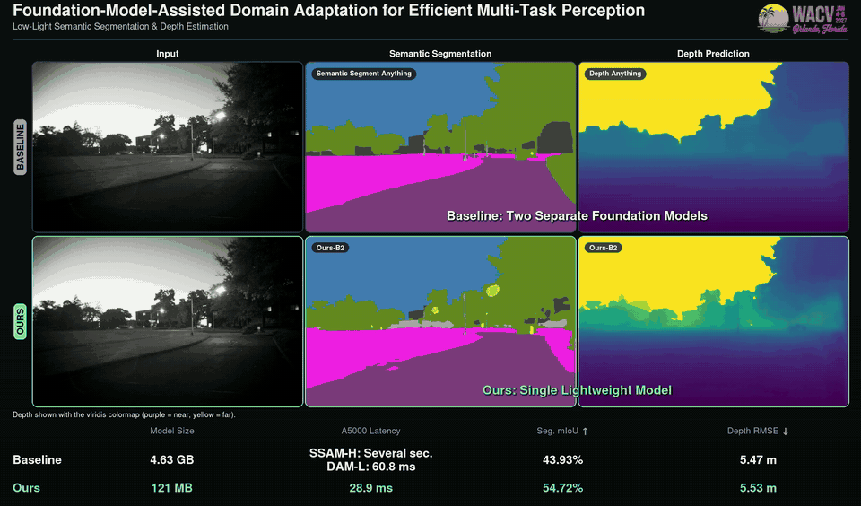

<h1 align="center">FAMDA</h1>
<h3 align="center">Foundation-Model-Assisted Domain Adaptation for Efficient Multi-Task Perception</h3>

<p align="center">
  <a href="#"></a>
  <a href="#"></a>
  <a href="https://github.com/beomseokg/FAMDA"></a>
  <a href="LICENSE"></a>
</p>

<p align="center">
  <a href="assets/lowlight_demo.mp4"></a>
  <br>
  <sub>Low-light field data. <b>Top:</b> two separate foundation models (Semantic Segment Anything + Depth Anything, 4.63 GB).
  <b>Bottom:</b> a single FAMDA MiT-B2 student (121 MB). Click for the full-resolution video.</sub>
</p>

This is the **official implementation** of *"Foundation-Model-Assisted Domain Adaptation for
Efficient Multi-Task Perception"* (WACV 2027).

Foundation models such as SAM and Depth Anything generalize remarkably well across domains,
but they are slow, large, and each only solves one task. FAMDA is a self-training framework for
unsupervised domain adaptation (UDA) in multi-task dense prediction that keeps their
generalization while dropping their cost: during training, SAM refines the teacher's semantic
pseudo-labels on the target domain and Depth Anything (DAM) supplies target pseudo-depth; at
inference, only a **single lightweight student** (SegFormer MiT-B0–B5 or DeepLab-V2) runs and
predicts segmentation and depth in one forward pass.

The code builds on [DAFormer](https://github.com/lhoyer/DAFormer) (MMSegmentation v0.16) and
covers the standard synthetic-to-real multi-task UDA benchmarks,
**SYNTHIA → Cityscapes** and **Virtual KITTI 2 → Cityscapes**.

---

## Install

Python 3.8 and a CUDA GPU are required. MiT-B5 training peaks at roughly 36–40 GB of GPU memory,
so a 40 GB+ card (A100 / A6000) is recommended. The pinned PyTorch build (1.9.1 + CUDA 11.1)
supports GPUs up to `sm_86`.

```bash
git clone https://github.com/beomseokg/FAMDA.git
cd FAMDA
conda create -n famda python=3.8 -y && conda activate famda

pip install -r requirements.txt -f https://download.pytorch.org/whl/torch_stable.html
pip install torch==1.9.1+cu111 torchvision==0.10.1+cu111 -f https://download.pytorch.org/whl/torch_stable.html
pip install mmcv-full==1.3.7
pip install timm==1.0.15 pycocotools==2.0.7
```

### Pretrained weights

| | where | source |
| --- | --- | --- |
| MiT-B0 / B1 / B2 / B5 ImageNet weights (`mit_b*.pth`) | `pretrained/` | [SegFormer](https://github.com/NVlabs/SegFormer) |
| Depth Anything ViT-L | downloaded automatically on first run (`LiheYoung/depth_anything_vitl14`, ~1.3 GB, Hugging Face cache) | [Depth Anything](https://github.com/LiheYoung/Depth-Anything) |
| DINOv2 hub code (used by Depth Anything) | already in `torchhub/` | [DINOv2](https://github.com/facebookresearch/dinov2) |

```bash
mkdir -p pretrained   # put mit_b0.pth ... mit_b5.pth here
```

---

## Datasets

```
data/
├── cityscapes/
│   ├── leftImg8bit/  gtFine/  disparity/  camera/
│   └── sam_mask_small/        # pre-computed SAM masks
├── synthia/
│   └── RAND_CITYSCAPES/
└── vkitti2/
```

| dataset | download | extract to |
| --- | --- | --- |
| **Cityscapes** | `leftImg8bit_trainvaltest.zip`, `gtFine_trainvaltest.zip`, `disparity_trainvaltest.zip`, `camera_trainvaltest.zip` from [cityscapes-dataset.com](https://www.cityscapes-dataset.com/) | `data/cityscapes/` |
| **SAM masks** | `sam_mask_small.zip` — **TODO: link** | `data/cityscapes/` |
| **SYNTHIA** | `SYNTHIA-RAND-CITYSCAPES` from [synthia-dataset.net](http://synthia-dataset.net/downloads/) | `data/synthia/` |
| **Virtual KITTI 2** | `vkitti_2.0.3_rgb.tar`, `vkitti_2.0.3_depth.tar`, `vkitti_2.0.3_classSegmentation.tar` from [NAVER LABS Europe](https://europe.naverlabs.com/proxy-virtual-worlds-vkitti-2/) | `data/vkitti2/` |

SAM is **not** run during training: FAMDA reads the pre-computed masks in
`data/cityscapes/sam_mask_small/**/*.pkl`, which keeps training cost close to plain DAFormer.

Then convert the labels and compute the rare-class-sampling statistics:

```bash
python tools/convert_datasets/cityscapes.py data/cityscapes --nproc 8
python tools/convert_datasets/synthia.py    data/synthia/   --nproc 8
python tools/convert_datasets/vkitti2.py    data/vkitti2    --nproc 8
```

---

## Quickstart

FAMDA with a MiT-B5 student on VK2 → CS:

```bash
python run_experiments.py --config configs/daformer_mtl/vk2cs_uda_warm_fdthings_rcs_croppl_a999_daformer_mitb5_s0_sd_SAM_DAM.py
```

Every run trains for 40k iterations on one GPU. Logs and checkpoints go to
`work_dirs/local-basic/<timestamp>_<config name>_<hash>/`.

To evaluate a trained checkpoint:

```bash
python tools/test.py <work_dir>/<run>.json <work_dir>/latest.pth --eval mIoU
```

---

## Reproducing the paper

All configs live in `configs/daformer_mtl/` and are named

```
{syn2cs | vk2cs}_uda_warm_fdthings_rcs_croppl_a999_daformer_{backbone}_s{seed}_{tasks}[_SAM][_DAM].py
```

| field | values |
| --- | --- |
| `backbone` | `mitb0`, `mitb1`, `mitb2`, `mitb5` (SegFormer), `dlv2` (DeepLab-V2, ResNet-101) |
| `tasks` | `s` segmentation, `d` depth, `n` surface normals (e.g. `sd`, `sdn`) |
| `SAM` / `DAM` | foundation model used to build target pseudo-labels |

| experiment | configs |
| --- | --- |
| **Main results** — SYN→CS and VK2→CS | `{syn2cs,vk2cs}_…_{mitb0,mitb1,mitb2,mitb5,dlv2}_s0_sd_SAM_DAM.py` |
| **Ablation** — w/o SAM (VK2→CS) | `vk2cs_…_{mitb0,mitb1,mitb2,mitb5}_s0_sd_DAM.py` |
| **Ablation** — segmentation only / depth only (VK2→CS) | `vk2cs_…_mitb5_s0_s_SAM.py`, `vk2cs_…_mitb5_s0_d_DAM.py` |
| **Three tasks** — seg + depth + normals (SYN→CS) | `syn2cs_…_{mitb0,mitb1,mitb2,mitb5,dlv2}_s0_sdn_SAM_DAM.py` |
| Baseline without any foundation model (VK2→CS) | `vk2cs_…_{mitb0,mitb1,mitb2,mitb5}_s0_sd.py` |

**Metrics.** Segmentation is reported as mIoU over the classes shared with Cityscapes
(16 for SYN→CS, 8 for VK2→CS), depth as RMSE in meters, and normals as the mean angular error.
The training logs average IoU over all 19 Cityscapes classes; rescale by 19/16 (SYN→CS) or
19/8 (VK2→CS) to get the numbers reported in the paper.

---

## Repository layout

```
mmseg/models/uda/dacs.py      FAMDA self-training: SAM-refined seg pseudo-labels, DAM pseudo-depth
mmseg/models/decode_heads/    DAFormer / DeepLab-V2 heads with parallel seg / depth / normal branches
mmseg/datasets/               Cityscapes, SYNTHIA and Virtual KITTI 2 loaders with depth
configs/daformer_mtl/         experiment configs (see table above)
depth_anything/  torchhub/    Depth Anything (DAM) and its DINOv2 backbone
segment_anything/             SAM code (imported by dacs.py; no SAM checkpoint is needed for training)
tools/                        dataset conversion, training and testing
run_experiments.py            training entry point
```

---

## Acknowledgements

This code builds on [DAFormer](https://github.com/lhoyer/DAFormer),
[MMSegmentation](https://github.com/open-mmlab/mmsegmentation),
[SegFormer](https://github.com/NVlabs/SegFormer), [DACS](https://github.com/vikolss/DACS),
[Segment Anything](https://github.com/facebookresearch/segment-anything),
[Depth Anything](https://github.com/LiheYoung/Depth-Anything) and
[DINOv2](https://github.com/facebookresearch/dinov2). We thank the authors for releasing their code.

## License

Apache License 2.0. Some included components carry their own licenses; see
[LICENSES.md](LICENSES.md).

---

## Citation

```bibtex
@inproceedings{famda2027,
  title     = {Foundation-Model-Assisted Domain Adaptation for Efficient Multi-Task Perception},
  author    = {TODO},
  booktitle = {Proceedings of the IEEE/CVF Winter Conference on Applications of Computer Vision (WACV)},
  year      = {2027}
}
```
